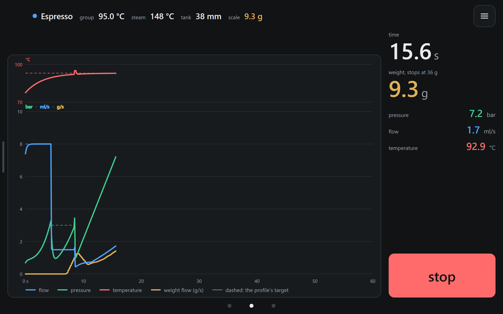

# pureflow

An unofficial skin for [Decaid](https://github.com/decentespresso/decaid), Decent's app for the
DE1 espresso machine. It replaces Decaid's default skin, Streamline, with a calm dark screen for
an Android tablet in landscape, and it is built around an editor for A-Flow 3.0 profiles. It is
for people who own a DE1 and run Decaid on a tablet. A scale is optional, but the steam timer and
the stop at weight need one.

## What it does

- **Home is also the shot screen.** It draws the shot live: blue is flow, green pressure, red
  temperature, yellow the weight. The finished shot stays until the next one. The profile and
  bean buttons sit on the right.
- **Three pages in a row**: hot water, home and steam, swiped sideways. A swipe from the left
  edge of home opens the shot history; a swipe from left to right goes back everywhere else.
- **The A-Flow 3.0 editor.** The graph is the editor: drag a line to change a flow, pressure or
  temperature, drag a border to change a time, tap a chip to type a value. Older A-Flow profiles
  open in it too. Any other profile opens in a step editor.
- **The profile picker** shows an estimate of the shot a profile would give.
- **Beans and grinders**, picked for the next shot and saved with it; a bean can keep a photo of
  its bag.
- **The steam timer** sets the time from the milk's weight on the scale. **Hot water** stops at a
  weight, a volume or a time.
- **Settings**: Decaid's and the machine's, and the skin's own.

## Install and use

- [Install](docs/user/install.md): the ZIP or its URL in Decaid, updates and your settings
- [Guide](docs/user/guide.md): what is the skin's own and not obvious
- [Troubleshooting](docs/user/troubleshooting.md): the connection, the scale, the steam timer,
  the bag photo, and the way back to Streamline

## State

pureflow is a beta. The version is 0.8.0; it is set in `package.json` and
`public/manifest.json`, and a test keeps the two equal.

## Development

Needs Node.js 22 or newer. The stack is TypeScript, Vite, Svelte and Vitest, with Playwright for
the browser tests.

| Step | Command | Result |
|---|---|---|
| Install | `npm ci` | the packages in `node_modules/` |
| Dev server | `npm run dev` | the skin on port 24800 |
| Type check | `npm run check` | checks the TypeScript and Svelte sources |
| Lint | `npm run lint` | ESLint, and the font sizes |
| Format | `npm run format:check` | Prettier, without writing |
| Test | `npm test` | runs the Vitest tests once |
| Browser tests | `npm run e2e` | the Playwright tests on fixture data and a mocked gateway |
| Build | `npm run build` | the static skin in `dist/`, with `index.html` and `manifest.json` at its root |
| Zip | `npm run zip` | builds, then writes `release/pureflow-<version>.zip` with `index.html` at the ZIP's root |
| Publish check | `npm run publish-check` | no local path, personal address or token in the files |
| All checks | `npm run verify` | check, lint, format, test, build, the publish and docs checks and `npm audit`, as CI runs them |
| Release | `npm run release` | the checks, the changelog from the commits, the version, the ZIP, the tag, then the GitHub release after a yes; `--dry-run` and `--local` change less |

`npm run e2e:rig` runs the tests that need a running Decaid with its simulated machine and
scale ([the rig](docs/architecture.md#the-rig)). How the skin is built, its modules and its checks
are in [docs/architecture.md](docs/architecture.md).

How to send a change, and the commit messages the release notes are made from, are in
[CONTRIBUTING](CONTRIBUTING.md). What changed in each version is in the [CHANGELOG](CHANGELOG.md),
and how to report a vulnerability privately is in [SECURITY](SECURITY.md).

## Credits

The step editor (`src/steps/`), the settings page (`src/settings-page/`) and the shot's
per-phase table (`src/shell/phases.ts`) are ported from
[Streamline.js](https://github.com/decentespresso/streamline-js) v0.2.14 (a few files from
v0.2.17), "A browser-native skin for Decent Espresso machines", Copyright (C) 2025-2026 Decent
Espresso, licensed under the GNU General Public License v3.0 or later as its `LICENSE.txt`
states; it is used here under GPL-3.0. Each ported file carries that notice, and
[NOTICE](NOTICE) lists them. `src/steps/fixtures/bundled-profiles.json` holds the 73 profiles
Decaid 0.8.8 bundles (Decaid is GPL-3.0-or-later), with their numbers as numbers, as test data.

A-Flow was forked from D-Flow by Damian Brakel; the editor here writes A-Flow 3.0 in
TypeScript, and [Jan3kJ/A_Flow](https://github.com/Jan3kJ/A_Flow) is the previous version of
A-Flow, the Tcl plugin for Decent's old app. Many ideas are inspired by
[DSx2](https://github.com/Damian-AU/DSx2), Damian Brakel's skin for Decent's old app.

## Licence

pureflow is licensed under the GNU General Public License, version 3 only (`GPL-3.0-only`): see
[LICENSE](LICENSE). The parts taken from other works and their licences are in
[NOTICE](NOTICE).
