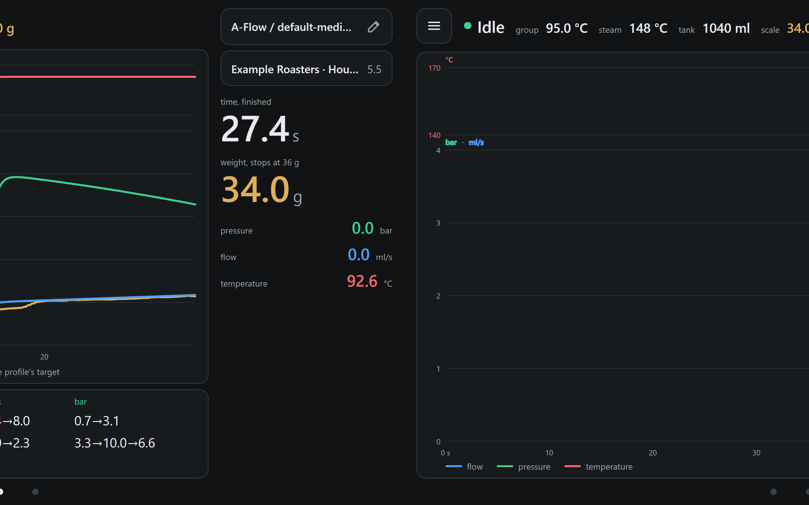
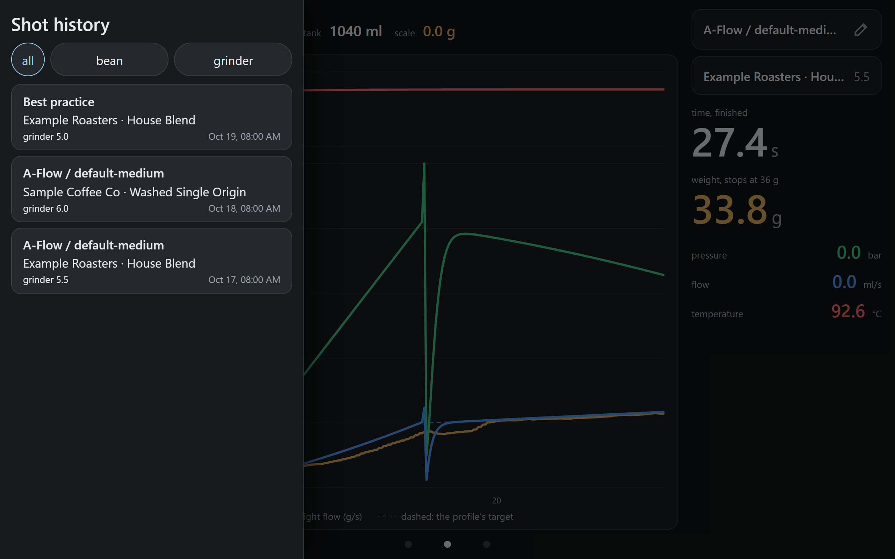
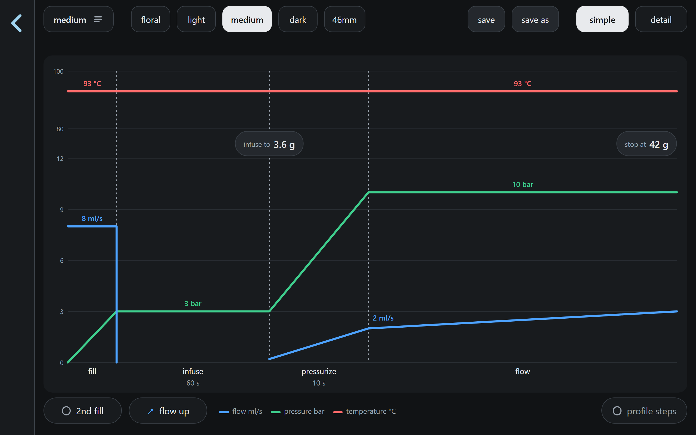
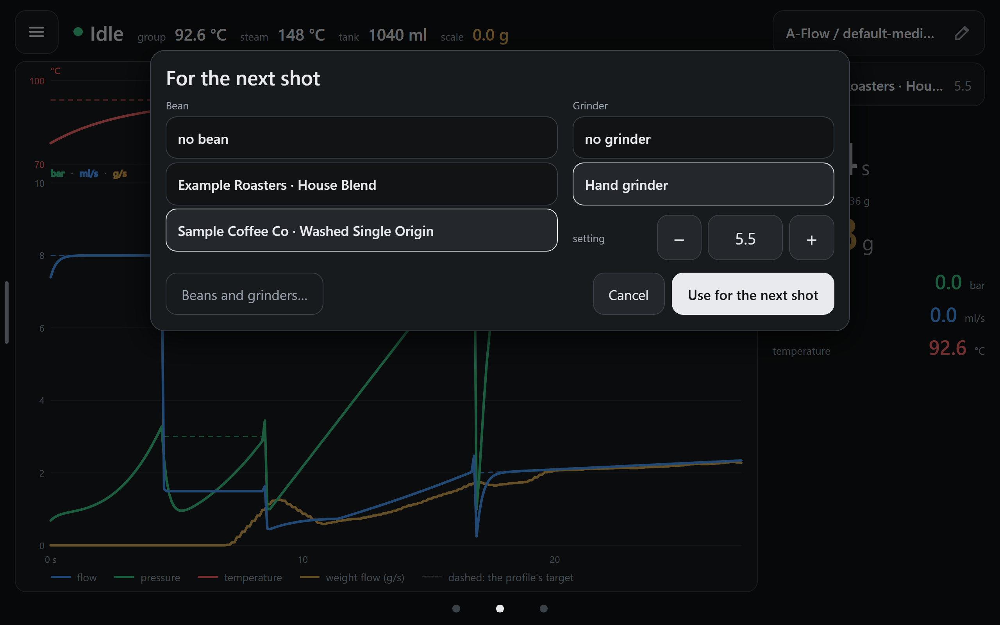
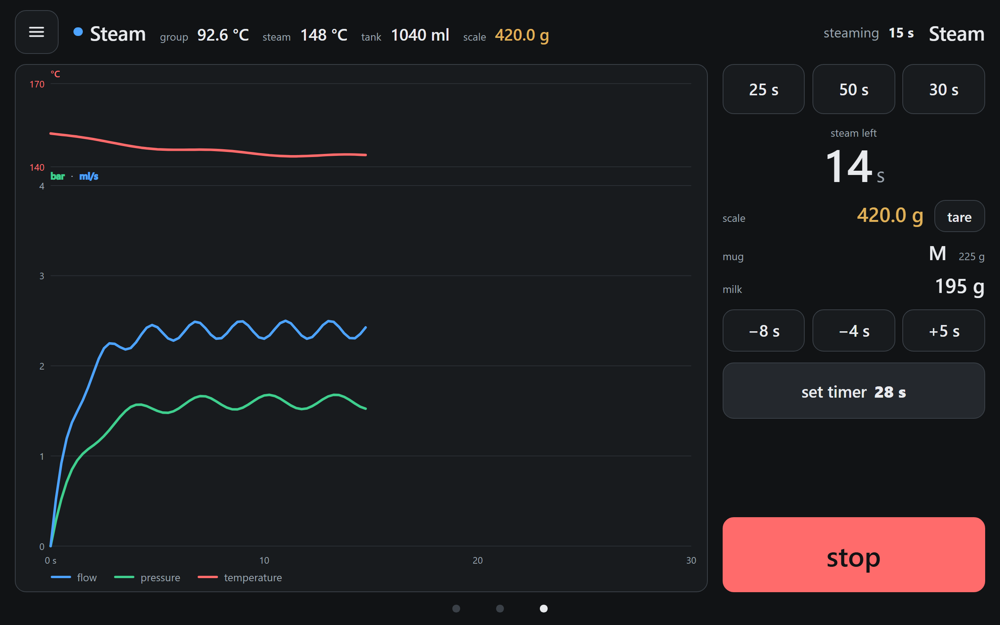
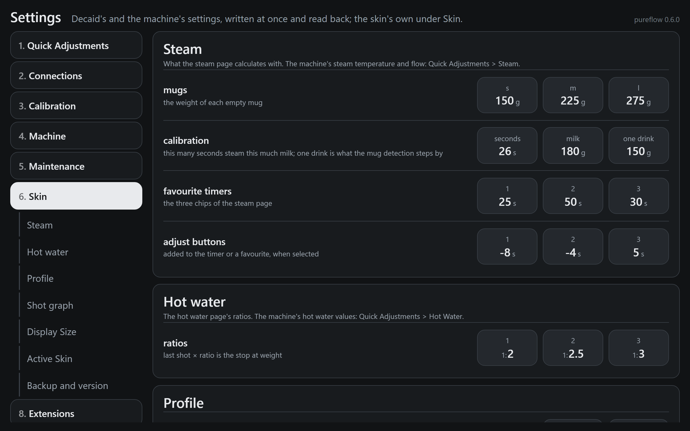

# Using pureflow

Only what is the skin's own and not obvious. For the DE1 itself and Decaid's settings, see
[Decent's documentation](https://decentespresso.com/docs) and
[Decaid](https://github.com/decentespresso/decaid).

Checked against pureflow 0.6.1.

## Pages, the corner menu and the swipe back

The skin has three pages in a row: **hot water**, **home** and **steam**. Swipe sideways to
move between them; the dots at the bottom show where you are.

- The button in the top left corner opens the menu on all three pages: settings, beans and
  grinders, clean, steam on or off, the machine's sleep and wake.
- There is no back button anywhere. **To go back, swipe from left to right.** This leaves the
  editors, the settings, the beans screen and the profile picker. The one exception is the hot
  water page: home lies to its right, so you swipe from right to left.
- On home, a swipe that starts at the left edge opens the **shot history** instead. It has one
  entry per profile and bean. Tap an entry to load its profile, bean and grinder setting for the
  next shot; the graph of its last shot shows on home. Swipe to the left, or tap the handle, to close it.

A swipe does not start on a slider, the editor's graph or a list row that swipes on its own.

## Home is also the shot screen

Start a shot at the machine. Home draws it live: blue is flow, green pressure, red temperature,
yellow the weight. While it runs the header names the running step. After it the right column
reads **time, finished** and keeps the shot until the next one starts.

A tap on the scale's weight in the top line tares the scale.

## The profile picker and its estimate

Tap the profile's name on home to open the picker. Tap a profile to see it; **load** sends it
to the machine.

The graph shows an **estimate** of the shot: the flow, pressure and temperature a shot of this
profile would roughly show. The profile's own targets are the dotted lines under it. The line
under the graph says it plainly: a real shot differs with the coffee.

## The A-Flow editor

Tap the pencil next to the profile's name. An A-Flow profile opens in the A-Flow editor; any
other profile opens in a step editor.

The graph is the editor. It has four phases, left to right:

- **fill**: water fills the basket at a set flow.
- **infuse**: the puck soaks at a low pressure, until a time or the weight on the chip
  **infuse to**.
- **pressurize**: the pressure rises to the pour pressure.
- **flow**: the pour, at a flow that rises (**flow up**) or falls (**flow down**), until the
  weight on the chip **stop at**.

In **simple** mode, drag a line up or down to change a flow, pressure or temperature. Drag a
dashed border sideways to change a time. Tap a chip to type its value. **2nd fill** adds a second
fill and a pause after infuse. **detail** shows every value of the selected phase.

The row at the top holds five profiles to start from. **save** and **save as** store the profile
in Decaid and load it on the machine. Leaving the editor with changes asks first.

Older A-Flow profiles open in the editor too and are saved as A-Flow 3.0. **Convert to 3.0**
under Settings > 6. Skin > Profile converts all of them at once.

## Beans, grinders and the bag photo

The bean button on home picks the bean, the grinder and its setting for the next shot. The
shot is saved with them, and the history can filter by them.

To add or change beans, open **Beans and grinders** from the menu, or from this dialog. In a
bean's form, **Photo** takes a picture of the bag with **Capture**. It is kept with the bean
when you save. **New photo** replaces it and **Remove photo** deletes it. The photo stays in
Decaid on the tablet; nothing is sent away.

## The steam timer

Steam is started at the machine. The steam page sets its timer from the milk's weight.

Put the mug with milk on the scale. The skin tells which mug it is (**s**, **m** or **l**, by
its weight) and how much milk is in it. **set timer** sends the time to the machine. Use the
three chips at the top for a time without a scale. The adjust buttons add or take seconds, for
colder or warmer milk. While steaming, **steam left** counts down, and a tap on an adjust button
changes the running timer at once: forgot **+5 s**? Tap it and 5 s are added; tap it again to
take them off. A timer shorter than the time already steamed ends the steam.

## The ring

While hot water or a flush runs, a large ring covers the screen's main area, on every screen.
It shows the time and has the **stop** button. The rest of the screen stays.

## Hot water

Hot water is started at the machine. With a scale it stops at the weight; without one at the
volume or the time. The ratio buttons set the weight from the last shot, for example 1:2.

## The settings that matter

The skin's own settings are under **Settings > 6. Skin**. The other categories are Decaid's
and the machine's.

- **Steam**: the weight of each empty mug, the calibration (this many seconds steam this much
  milk), the three favourite timers and the adjust buttons.
- **Hot water**: the three ratios.
- **Profile**: the highest flow the editor offers, the dose, the start row of the editor, and
  **Convert to 3.0**.
- **Display Size**: the size of everything on screen and the line width.
- **Active Skin**: Decaid's skins; a tap on another one switches to it.
- **Backup and version**: the backup in Decaid and the skin's version.

One of the skin's settings sits with the machine's: **tank unit**, under **1. Quick
Adjustments > Water Tank**, shows the tank on the state line in ml or in mm.

The two sleep entries of the menu differ: **Machine sleep** puts only the DE1 to sleep;
**Machine and app sleep** also turns the skin dark, with 'touch to wake'. A touch on it wakes
the machine.
