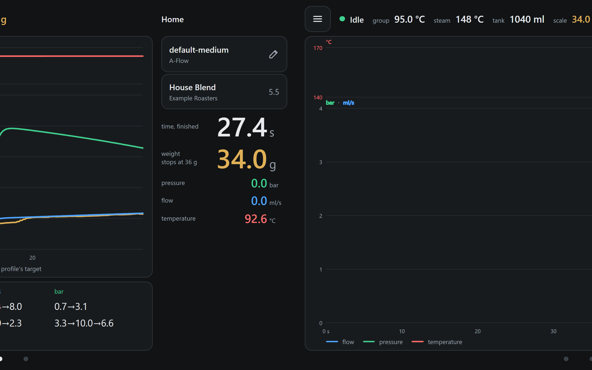
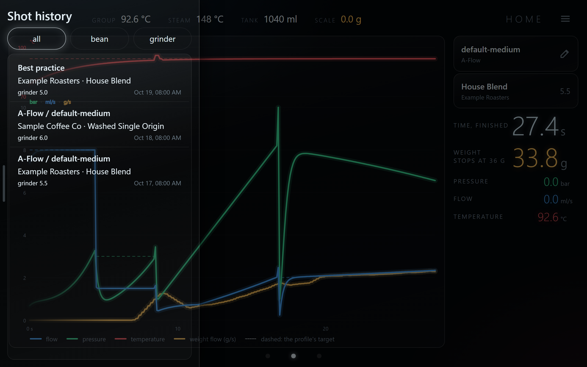
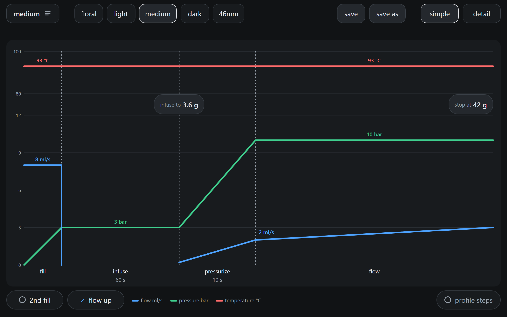
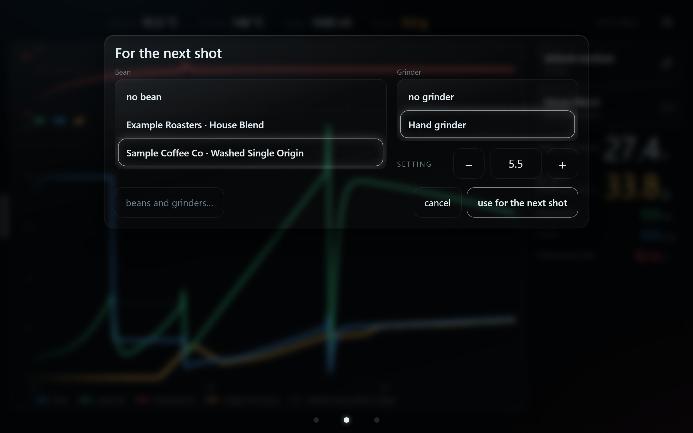
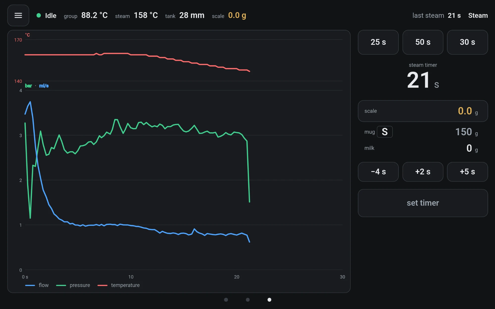
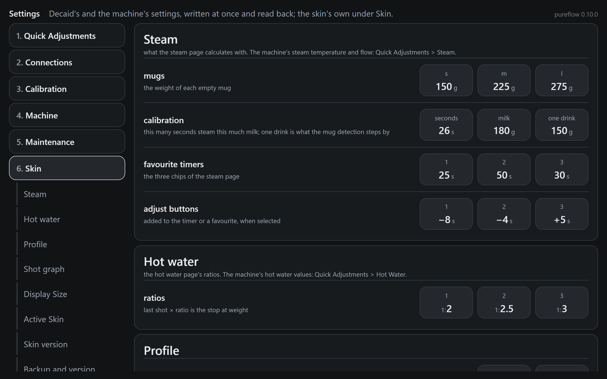

# Using pureflow

Only what is the skin's own and not obvious. For the DE1 itself and Decaid's settings, see
[Decent's documentation](https://decentespresso.com/docs) and
[Decaid](https://github.com/decentespresso/decaid).

Checked against pureflow 0.6.1.

## Pages, the corner menu and the swipe back

The skin has three pages in a row: **hot water**, **home** and **steam**. Swipe sideways to
move between them; the dots at the bottom show where you are. On a touch screen, put a finger
on the screen and move it. With a mouse on a PC, press the button, hold it and drag the same way.
It feels less natural there, but it works.

- The button in the top left corner opens the menu on all three pages: settings, beans and
  grinders, clean, steam on or off, the machine's sleep and wake.
- There is no back button anywhere. **To go back, swipe from left to right.** This leaves the
  editors, the settings, the beans screen and the profile picker. The one exception is the hot
  water page: home lies to its right, so you swipe from right to left.
- On home, a swipe that starts at the left edge opens the **shot history** instead. It has one
  entry per profile and bean. Tap an entry to load its profile, bean and grinder setting for the
  next shot; the graph of its last shot shows on home, with its time and weight in the right
  column, until the next shot starts. Swipe to the left, or tap the handle, to close it.

A swipe does not start on a slider or the editor's graph. In the profile picker a swipe to the
right on a row goes back too, unless the row is open: then it closes the row.

## Home is also the shot screen

Start a shot at the machine. Home draws it live: blue is flow, green pressure, red temperature,
yellow the weight. While it runs the header names the running step. The right column holds the
time, the weight and the live values, each caption on the left and its number on the right; under
**weight** it says where the shot stops. After the shot the column reads **time, finished** and
keeps the shot until the next one starts. A line under the weight says why it stopped, as Decaid
saw it: **stopped at the target weight**, **stopped at the target volume**, **stopped by hand** or
**ended by the machine**. A shot from the history has no such line.

A tap on the scale's weight in the top line tares the scale.

## The profile picker and its estimate

Tap the profile's name on home to open the picker. Tap a profile to see it; **load** sends it
to the machine. **edit** beside it sends it to the machine too and opens it in its editor.

Swipe a profile's row to the left to show **rename** and **delete** under its right end; swipe
it back to the right, or tap elsewhere, to close it. The skin's A-Flow defaults have neither, and
the profile loaded on the machine can be renamed but not deleted.

The graph shows an **estimate** of the shot: the flow, pressure and temperature a shot of this
profile would roughly show. The profile's own targets are the dotted lines under it. A ramp's
target falls or rises at the step's own pace, so where the stop weight or an exit ends a step
early, the line shows only the part of the ramp the machine gets before then. It is an estimate
from the steps; a real shot differs with the coffee.

## The A-Flow editor

Tap the pencil next to the profile's name. An A-Flow profile opens in the A-Flow editor; any
other profile opens in a step editor.

The graph is the editor. It has four phases, left to right:

- **fill**: water fills the basket at a set flow.
- **infuse**: the puck soaks at a low pressure, until a time or the weight on the chip
  **infuse to**.
- **pressurize**: the pressure rises to the pour pressure.
- **flow**: the pour, at a flow that rises (**flow up**) or falls (**flow down**), until the
  weight on the chip **stop at**.

In **simple** mode, drag a line up or down to change a flow, pressure or temperature. Drag a
dashed border sideways to change a time. Tap a chip to type its value. **2nd fill** adds a second
fill and a pause after infuse. **detail** shows every value of the selected phase.

The row at the top holds five profiles to start from. **save** and **save as** store the profile
in Decaid and load it on the machine. Leaving the editor with changes asks first.

Older A-Flow profiles open in the editor too and are saved as A-Flow 3.0. **convert to 3.0**
under Settings > 6. Skin > Profile converts all of them at once.

## Beans, grinders and the bag photo

The bean button on home picks the bean, the grinder and its setting for the next shot. The
shot is saved with them, and the history can filter by them.

To add or change beans, open **Beans and grinders** from the menu, or from this dialog. In a
bean's form, **photo** takes a picture of the bag with **capture**. It is kept with the bean
when you save. **new photo** replaces it and **remove photo** deletes it. The photo stays in
Decaid on the tablet; nothing is sent away.

The skin with bag reading (the ZIP whose name ends in `-ocr`) also reads a new photo, on the
tablet itself. While it reads, the form says **Reading the bag**; **cancel** stops it. Then the
lines it read are buttons under the photo, the likely name first and the likely roaster second.
Choose **name** or **roaster** at the start of the row and tap a line to put it in that field;
the choice then moves to the other field. Nothing is filled in until you tap.

## The steam timer

Steam is started at the machine. The steam page sets its timer from the milk's weight.

Put the mug with milk on the scale. The skin tells which mug it is (**s**, **m** or **l**, by
its weight) and how much milk is in it. **set timer** sends the time to the machine. Use the
three chips at the top for a time without a scale. The adjust buttons add or take seconds, for
colder or warmer milk. While steaming, **steam left** counts down, and a tap on an adjust button
changes the running timer at once: forgot **+5 s**? Tap it and 5 s are added; tap it again to
take them off. A timer shorter than the time already steamed ends the steam.

## The ring

While hot water or a flush runs, a large ring covers the screen's main area, on every screen.
It shows the time and has the **stop** button. The rest of the screen stays.

## Hot water

Hot water is started at the machine. With a scale it stops at the weight; without one at the
volume or the time. The ratio buttons set the weight from the last shot, for example 1:2; without a weighed last shot (none, or 0 g) they are grayed out and do nothing.

## Cleaning with detergent

Settings > Maintenance > **Clean with detergent** leads you through three steps. Put a blind
basket with 3 g of detergent in the portafilter, lock it in and tap **start**, then **load**: the skin
loads the profile Cleaning/Forward Flush x5, and you start it at the machine (a machine without
this profile says 'the profile is not on this machine' and nothing is loaded). The card follows the run;
stopped at the machine, it stays at this step. Next, take the portafilter out and **flush** for
10 s. Last comes the machine's cleaning cycle, the same as **Clean**: **clean** starts it, **finish**
leaves it out. At the end, or on **cancel**, your earlier profile comes back with its target weight
and dose, unsaved changes included.

## Your own tank table

The tank's level is measured in mm, and the skin turns it into ml with Decent's table. If the ml
look wrong for your tank, Settings > 1. Quick Adjustments > **Tank calibration** makes your own
table:

1. Set a refill kit to 'force off' first, then empty the tank. If the level looked low before,
   lift the uptake assembly out of the water for 5 to 10 s and put it back.
2. Keep the machine level. When **now** says 'steady', tap **next**: that is the empty tank.
3. Pour 250 ml, slowly, weighed on a scale (1 g = 1 ml), wait for 'steady' and tap **next**.
   Repeat. A step that raised the level less than 3 mm or more than 15 mm is refused: let the
   water settle, or check the amount.
4. From 1000 ml **done** saves the table; going on to the full tank is not needed. **start
   again** drops the steps; leaving the page keeps the table saved before.

**using** says which table is in force; **back to decent's table** removes yours. The state line,
the water alert's note and the clean's check of 350 ml then follow your table. The machine still
works in mm: the water alert and its refill warning do not change. The sensor reads to about a mm,
which is about 30 ml, so expect no better than that. The table belongs to this tank: it is not in
the settings backup, and a new tank or moved tubes mean **start again**.

## The settings that matter

The skin's own settings are under **Settings > 6. Skin**. The other categories are Decaid's
and the machine's.

The filter above the categories finds a setting in all of them: type a word or two, change the
setting right there, or tap the name over it to go to its place.

- **Steam**: the weight of each empty mug, the calibration (this many seconds steam this much
  milk), the three favourite timers and the adjust buttons.
- **Hot water**: the three ratios.
- **Profile**: the highest flow the editor offers, the dose, the start row of the editor, and
  **convert to 3.0**.
- **Display Size**: the size of everything on screen and the line width.
- **Active Skin**: Decaid's skins; a tap on another one switches to it. **check** has Decaid look
  for newer versions; when it holds another pureflow than this screen runs, **reload** loads it.
- **Skin version**: the flavour, **small** or **with the bean bag reading**, and **list**, which
  asks GitHub for pureflow's releases; a tap on one has Decaid install it, then **reload** loads
  it. See [install](install.md#choose-the-version-in-the-skin).
- **Backup and version**: the backup in Decaid and the skin's version.

One of the skin's settings sits with the machine's: **tank unit**, under **1. Quick
Adjustments > Water Tank**, shows the tank on the state line in ml or in mm.

The two sleep entries of the menu differ: **Machine sleep** puts only the DE1 to sleep;
**Machine and app sleep** also turns the skin dark, with 'touch to wake'. A touch on it wakes
the machine. While the machine sleeps and the skin is awake, the menu shows **Wake machine** and, last,
**Machine and app sleep**, which then only turns the skin dark; a two-finger swipe down on hot
water, home or steam does the same.
