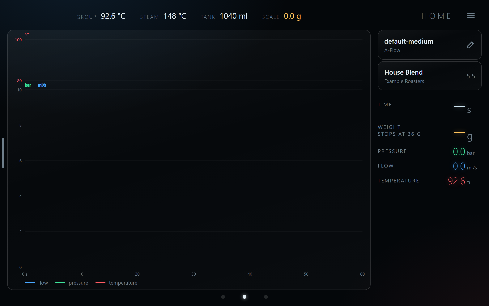

# Install pureflow

pureflow is an unofficial skin for [Decaid](https://github.com/decentespresso/decaid), Decent's
app for the DE1 espresso machine. It replaces Decaid's default skin, Streamline. You need a DE1
and Decaid on an Android tablet. A scale is optional, but the steam timer and the stop at weight
need one.

Checked against pureflow 0.11.0.

## Install the ZIP

1. Get the skin's ZIP, `pureflow.zip`, from the
   [releases](https://github.com/Jan3kJ/decaid-pureflow/releases), and copy it to the tablet,
   for example into `Download`.
2. In Decaid, open the skin installer and choose the ZIP file. Decent describes this in
   [Decaid's skin page](https://github.com/decentespresso/decaid/blob/v0.8.8/doc/Skins.md).
3. Pick the ZIP. Decaid unpacks it, makes it the default skin and opens it.

The file's name does not carry the version, so a second download may overwrite the first or need
renaming by hand. The version of an installed file is under **Settings > 6. Skin > Backup and
version**.

## Install by URL

Once a release is published, Decaid can also install it by its address. Copy the link of the
ZIP from the release page and give it to Decaid's skin installer (see
[Decaid's skin page](https://github.com/decentespresso/decaid/blob/v0.8.8/doc/Skins.md)). An
install by URL does not select the skin: select **pureflow** afterwards in Decaid's skin
selector.

### The asset field

Decaid's install from a GitHub release has an **asset** field. Type `pureflow.zip` into it for the
skin, or `pureflow-ocr.zip` for the skin that also reads the bean bag. Every release carries both
names, so the field stays the same from version to version and the check for updates finds the newer
file. If you leave the field empty, Decaid takes the first asset of the release, which is the ocr
ZIP (`-ocr` sorts before `.zip`), about 6 MB larger than the base one. The file name does not
carry the version; the release's page does. Releases up to 0.10.0 also carry
`pureflow-<version>.zip` and `pureflow-<version>-ocr.zip`, with the same files.

## Choose the version in the skin

Once pureflow runs, it can install another release or the other flavour itself:
**Settings > 6. Skin > Skin version**.

1. Pick the flavour: **small**, or **with the bean bag reading** (about 6 MB larger).
2. Tap **list**. Only then does the skin ask GitHub for pureflow's releases; it asks no other
   service. The newest is marked **latest**, the one this screen runs **running**. Without a
   network the page says that GitHub could not be reached; GitHub answers about 60 lists an hour
   per network.
3. Tap a release and **install**. Decaid downloads the ZIP and installs it over pureflow, with your
   settings kept. The latest is installed from the GitHub release under `pureflow.zip` or
   `pureflow-ocr.zip`, so Decaid's check for updates installs the next releases. An older release
   is installed from the same name in that release; the check for updates then keeps that
   version until you install the latest here again.
4. Tap **reload**: the screen loads the installed version.

A release from before the fixed names (0.9.0 and older) is installed from its own ZIP,
`pureflow-<version>.zip` or `pureflow-<version>-ocr.zip`, also when it is the latest.

## What you see after

Decaid lists the skin as **pureflow** with its version. The skin opens on home:

- The top line shows the group and steam temperature, the water in the tank and the scale's
  weight; the menu is the icon at the top right. The top left corner stays empty while all is
  well; it names only a sleeping machine, a switched-off steam heater or a fault.
- On the right are the profile and the bean for the next shot, then the shot's time and weight.
- The three dots at the bottom are the three pages: hot water, home and steam. The
  [guide](guide.md) explains them.

The skin's version is also at the top right of its settings page.

## Updates and your settings

Every version has the id `pureflow`. A new ZIP installs over the old one and keeps your
settings. The skin also copies its settings to Decaid's own store with every change. If the
tablet's browser storage is lost, the skin restores them at the next start and says
'Settings restored from the backup in Decaid'. You can restore them by hand under
**Settings > 6. Skin > Backup and version > Restore from backup**.

## Opened outside Decaid

The skin talks to Decaid on the same device, on port 8080. If you open it in a browser where
no Decaid runs, it shows **Decaid is not reachable** and keeps trying. That is expected: open the
skin through Decaid.

To go back to Streamline, see [troubleshooting](troubleshooting.md#go-back-to-streamline).
