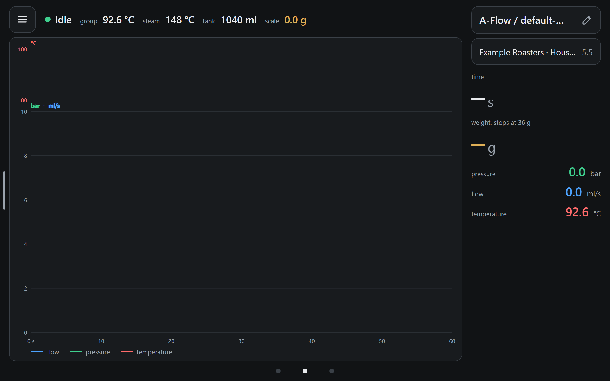

# Install pureflow

pureflow is an unofficial skin for [Decaid](https://github.com/decentespresso/decaid), Decent's
app for the DE1 espresso machine. It replaces Decaid's default skin, Streamline. You need a DE1
and Decaid on an Android tablet. A scale is optional, but the steam timer and the stop at weight
need one.

Checked against pureflow 0.6.1.

## Install the ZIP

1. Get the skin's ZIP, `pureflow-<version>.zip`, from the
   [releases](https://github.com/Jan3kJ/decaid-pureflow/releases), and copy it to the tablet,
   for example into `Download`.
2. In Decaid, open the skin installer and choose the ZIP file. Decent describes this in
   [Decaid's skin page](https://github.com/decentespresso/decaid/blob/v0.8.8/doc/Skins.md).
3. Pick the ZIP. Decaid unpacks it, makes it the default skin and opens it.

## Install by URL

Once a release is published, Decaid can also install it by its address. Copy the link of the
ZIP from the release page and give it to Decaid's skin installer (see
[Decaid's skin page](https://github.com/decentespresso/decaid/blob/v0.8.8/doc/Skins.md)). An
install by URL does not select the skin: select **pureflow** afterwards in Decaid's skin
selector.

## What you see after

Decaid lists the skin as **pureflow** with its version. The skin opens on home:

- The top line is the machine's state: `Idle`, the group and steam temperature, the water in
  the tank and the scale's weight.
- On the right are the profile and the bean for the next shot, then the shot's time and weight.
- The three dots at the bottom are the three pages: hot water, home and steam. The
  [guide](guide.md) explains them.

The skin's version is also at the top right of its settings page.

## Updates and your settings

Every version has the id `pureflow`. A new ZIP installs over the old one and keeps your
settings. The skin also copies its settings to Decaid's own store with every change. If the
tablet's browser storage is lost, the skin restores them at the next start and says
'Settings restored from the backup in Decaid'. You can restore them by hand under
**Settings > 6. Skin > Backup and version > Restore from backup**.

## Opened outside Decaid

The skin talks to Decaid on the same device, on port 8080. If you open it in a browser where
no Decaid runs, it shows **Decaid is not reachable** and keeps trying. That is expected: open the
skin through Decaid.

To go back to Streamline, see [troubleshooting](troubleshooting.md#go-back-to-streamline).
